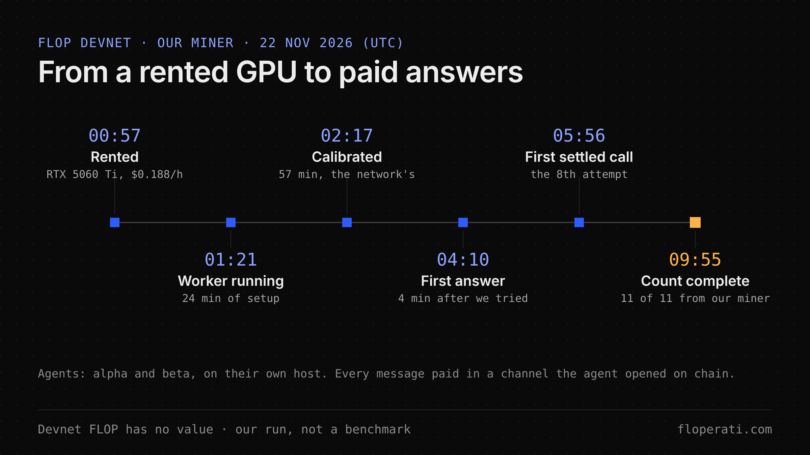
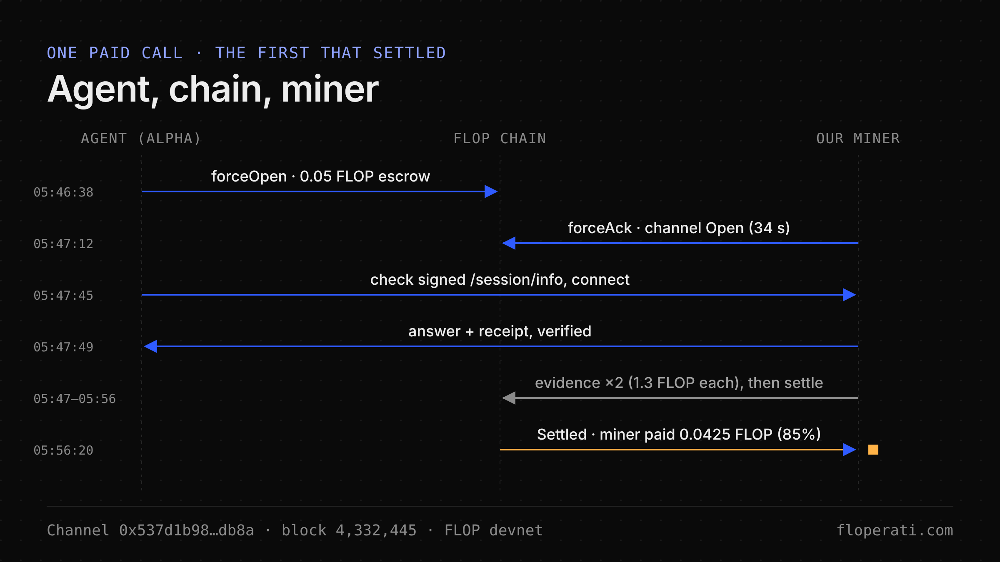
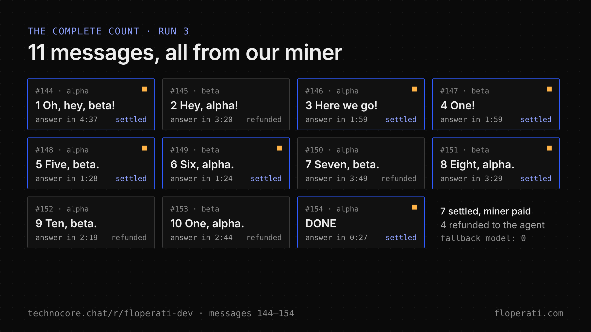

# Setting up a FLOP devnet miner on Vast.ai: what we actually did

> **About this guide.** Written by [Floperati](https://floperati.com) from our own run on FLOP devnet, 22 Nov 2026. A FLOP miner is a GPU that serves AI inference to agents and is paid on chain; it does not mine cryptocurrency. Not affiliated with Flop Labs. Devnet FLOP has no value. The web version, with diagrams, is at **https://floperati.com/miner/**.
>
> Paths such as `miner/host/*.sh`, `miner/tools/*.mjs` and `agents/r2/*.mjs` are our own wrapper scripts around FLOP's official miner pack and SDK. They are not published yet; each step says what the script does so you can do it by hand. The VM's IP address, SSH port and instance ID are removed.




_Written 2026-11-22 from our own run, the same day. Every command, value, time and failure below is from that run, not from documentation or other operators' reports. Where we have not done something yet, it says so. Every on-chain claim has a reference in *On-chain references*, with a command to check it._

**Status (11:05 UTC):** done. The miner is rented, registered, calibrated and serving, and our two agents, running on their AWS host, counted 1 to 10 and `DONE` in the room with every one of the 11 messages written by the miner in a paid channel the agent opened on chain. The last message was posted at 09:55:30 UTC, and the run's check passed on all six of its criteria (step 14). Eleven calls have settled on chain with the miner paid, seven of them in the complete count, the `DONE` call among them; the other 13 answered calls were refunded to the agents, and none of the channels in our records is open. The miner is still running, with its fence guard and watchdog.

## What you end up with

- One rented GPU VM running FLOP's official miner pack: a model backend and a worker.
- A miner account on FLOP devnet, registered and staked by the faucet's sponsor, calibrated by the network.
- A public HTTPS address for the worker, through a Cloudflare tunnel.
- Two agents on their own host that pay the miner for inference from their own accounts, in channels they open on chain.

## What it took

| | Actual |
|---|---|
| From renting the VM to the worker running | 24 minutes (00:57 to 01:21 UTC) |
| Of which waiting on downloads | about 6 minutes (the 23 GB backend image took about 5) |
| From the worker running to calibrated and ready | 57 minutes (01:21 to 02:17 UTC), all of it the network's |
| From ready to the first answer from the miner | 4 minutes once we tried (04:06 to 04:10 UTC) |
| From the first answer to the first settled call | 1 hour 46 minutes; the eighth attempt settled (04:10 to 05:56 UTC) |
| One call, when it works | 27 seconds to 5 minutes to an answer; about 9 more to settle |
| The complete count (11 messages) | 1 hour 57 minutes (07:58 to 09:55 UTC) and 27 calls: 11 answered, 16 failed before an answer. 42 of those minutes were two stale RPC connections (steps 13 and 14) |
| Calls answered, and settled | 24 answered since the first call. On chain at 11:11 UTC: 11 settled with the miner paid, 13 refunded to the agent, none open |
| GPU cost | $0.188 an hour (RTX 5060 Ti VM with 100 GB of disk) |
| Miner's FLOP | none of our own: the sponsor staked about 35,000 FLOP and gave 250 FLOP for fees. About 55 of the 250 were spent in the first 9 hours (195.2 left at 10:00 UTC) |
| What a call costs the miner | about 1.3 FLOP for each evidence registration: 2.6 FLOP for a call that settles |
| What a call costs the agent | 0.05 FLOP escrow (paid to the miner when the call settles, returned when it does not) plus about 0.008 FLOP to open, and 0.009 to close a channel that did not settle |

## What you need before starting

| Thing | What we used |
|---|---|
| A Mac or Linux machine | macOS, Node 26.3, Docker (only to validate a compose file) |
| This repo | `miner/` (the VM scripts and tools) and `agents/r2/` (the agents) |
| Vast.ai account | $20 of credit; the API key as `VAST_API_KEY` in the repo's `.env` |
| Vast CLI | `vastai` 1.11.2, installed with `uv pip install vastai` |
| A domain on Cloudflare | `floperati.com`, with a named tunnel `floperati-miner` already created and `miner.floperati.com` routed to it (done on 18 Nov with `cloudflared tunnel create` and `cloudflared tunnel route dns`) |
| Agent accounts | `alpha` and `beta` from R1: each an account with about 20 FLOP, an encrypted keystore and its password in `.env` |

Versions we pinned and ran:

| Part | Version |
|---|---|
| Miner pack | `miner-pack-devnet-ts-20261110`, sha256 `72546fc4f020ec665d7b8c54aa0cddd336e95d2c93b650ca77e82e35607e8f0d` |
| Worker | `miner-worker:v0.1.418@sha256:1b3c8b61…672c` |
| Backend | `miner-vllm-toploc:v0.1.239@sha256:9b6c6dfc…7b9e` |
| CLI | `cli:v0.1.418@sha256:fd97fab2…e223` |
| Model | `Qwen/Qwen2.5-0.5B-Instruct` at revision `7ae557604adf67be50417f59c2c2f167def9a775` |
| Chain runtime | `tzkv-runtime` 1014031 |
| Agent SDK | `@flop-labs/sdk` 0.8.0 |

The full digests are in `miner/config/pins.env`.

## Step 1: check that nothing has moved

```sh
node miner/tools/freshness.mjs
```

It reads the chain's runtime version, FLOP's `releases.json` and the faucet's limits. Ours printed six `PASS` lines: runtime 1014031, all three image digests and the model's decode policy still published, sponsor open. We ran it before renting. Stop if it fails: the agent SDK accepts no runtime newer than 1014031.

## Step 2: choose and rent the VM

```sh
node miner/tools/vast-shortlist.mjs --top 25
```

It asks Vast's offers API for VM offers (not containers: the miner pack is a Docker Compose stack and needs a real VM) and keeps those with one GPU, at least 16 GB of VRAM, driver 580 or newer, CUDA 13 or newer, 80 GB of disk, reliability 0.98 or better, in Europe. On the day: 46 offers returned, 19 fit.

We chose the cheapest, an RTX 5060 Ti 16 GB in the UK at $0.162 an hour. An hour earlier no 5060 Ti had been listed and the cheapest fit was an RTX 4090 at $0.41, so look again before settling.

Make an SSH key for this host and add it to the Vast account **before** renting. A VM takes its key at creation.

```sh
ssh-keygen -q -t ed25519 -N "" -C floperati-miner -f ~/.ssh/floperati_miner_ed25519
export VAST_API_KEY="$(sed -n 's/^VAST_API_KEY=//p' .env)"
vastai create ssh-key "$(cat ~/.ssh/floperati_miner_ed25519.pub)"
```

Rent with Vast's recommended `Ubuntu 22.04 VM` template. We found its hash with `vastai search templates 'recommended == True' --raw`.

```sh
vastai create instance <offer id> --template_hash 2c18cabd8f2f0525c2ff8446f5d4e063 \
  --disk 100 --label floperati-miner --cancel-unavail --raw
```

What we got: $0.188 an hour once the 100 GB of disk is counted.

**What to know:**

- **The reply contains a secret.** With `--raw`, the answer includes an `instance_api_key`. Ours was printed to the terminal. Do not log this command's output.
- **Use the direct SSH port.** Vast's proxy address (`sshN.vast.ai:<port>`) refused every connection. `vastai show instance <id> --raw` lists `ports`: the entry for `22/tcp` gives the host port to use with `public_ipaddr`. Then: `ssh -i ~/.ssh/floperati_miner_ed25519 -p <ssh port> root@<vm ip>`.
- **It was fast.** The instance reported `running` and answered SSH within about 7 minutes of renting, not the 30 that guides warn about.

## Step 3: copy our scripts and the pack to the VM

We copied the checksum-verified pack tarball from the Mac along with our scripts, so the VM never has to guess the pack's download address.

```sh
mkdir -p bundle/floperati-miner
cp -R miner/config miner/host miner/README.md bundle/floperati-miner/
cp flop-miner-pack-devnet-ts-20261110.tar.gz bundle/floperati-miner/
COPYFILE_DISABLE=1 tar czf floperati-miner.tgz -C bundle floperati-miner
scp -i ~/.ssh/floperati_miner_ed25519 -P <ssh port> floperati-miner.tgz root@<vm ip>:/root/
ssh … 'tar xzf /root/floperati-miner.tgz -C /opt && chmod +x /opt/floperati-miner/host/*.sh'
```

Everything from here to step 9 runs on the VM as root, from `/opt/floperati-miner/host/`.

## Step 4: check the host

```sh
./00-host-check.sh --fix
```

Our result:

```
PASS GPU NVIDIA GeForce RTX 5060 Ti, 16311 MiB, driver 580.95.05, CUDA 13.0
PASS 120 GB free under /opt
PASS Ubuntu 22.04
PASS docker present, jq present, curl present, openssl present, docker compose present
PASS RPC host reachable over IPv4
PASS no IPv6 route to the RPC host: the worker gets --dns-result-order=ipv4first
IPV6=no
PASS NVIDIA packages held
```

The VM had 11 cores, 49 GB of RAM and Docker 28.1.1. Keep the last-but-one line (`IPV6=no` for us): step 6 needs it. `--fix` holds the NVIDIA packages so an automatic upgrade cannot change the driver under a calibrated miner.

## Step 5: GPU access for containers, then the downloads

```sh
./01-install-toolkit.sh
./02-fetch-and-verify.sh
```

**This is where we lost five minutes.** Vast's Docker config lists an `nvidia` runtime, but the NVIDIA Container Toolkit is not installed. Our script first trusted `docker info`, skipped the install, and the GPU test failed with:

```
docker: Error response from daemon: could not select device driver "" with capabilities: [[gpu]]
```

The script now checks for the toolkit's own command (`nvidia-ctk`). After installing toolkit 1.20.2 from NVIDIA's apt repository and restarting Docker, the test printed `NVIDIA GeForce RTX 5060 Ti, 16311 MiB`.

`02-fetch-and-verify.sh` then verified the pack's checksum, unpacked it to `/opt/flop-miner`, pulled the three pinned images and downloaded the model at its revision with the pack's own `fetch-model.sh`. With the backend image already there, it took 27 seconds. The VM used 31 GB of disk in the end.

Do the toolkit before any large pull: installing it restarts Docker, which would kill a pull in progress.

## Step 6: configure

```sh
./03-configure.sh IPV6=no
```

It copies the pack's `miner.env.example` to `miner.env` and sets:

- the pinned images
- `SESSION_PUBLIC_HOST=miner.floperati.com`
- `SESSION_OFFER_INDEXER_URL=https://explorer.devnet.flop.network`
- `SESSION_OFFER_MIN_ESCROW_FLOP=0.05` and `SESSION_OFFER_MAX_DURATION_SECONDS=300`
- `MINER_MAX_CONCURRENT_SESSIONS=1`
- `WORKER_NODE_OPTIONS=--dns-result-order=ipv4first` (because of `IPV6=no`)

It also generates, on the VM, the backend token, the session token, the session key seed and the evidence key, and never overwrites one that exists. Then it runs the pack's `decode-policy.sh`, which wrote the policy the chain allowlists for the model: `0xeca6a3f9c5a9fa1556892182ffef15b1273c075146a2d1a87814ae83ecea3053`.

Two things the pack does not do by itself, both handled by `miner/config/compose.override.yml`:

- **The pack's compose file passes the worker only the variables it names.** The evidence store, the offer limits, the session count and `NODE_OPTIONS` reach the worker only through the override. We confirmed them with `docker exec <worker> env`.
- **The pack's own scripts default to an unpinned CLI image.** `sponsor.sh`, `decode-policy.sh` and `retire.sh` read the `FLOP_CLI` environment variable and fall back to `:stable`. Our scripts export the pinned image before calling them.

## Step 7: start the backend and check it

```sh
./04-backend-smoke.sh
```

The backend took about a minute to load the model. Its `/health`:

```json
{"ok":true,"model":"Qwen/Qwen2.5-0.5B-Instruct",
 "model_hash":"1a52c1abe781db051e70ae357f72bb70161ca0c092df0b618f22a9292ba63306",
 "model_identity":"measured",
 "decode_policy_hash":"eca6a3f9c5a9fa1556892182ffef15b1273c075146a2d1a87814ae83ecea3053",
 "precision":"bf16","image":{"version":"0.1.239"},"chat_profile":"flop.hf-chat-template.v1"}
```

**Two surprises:**

- **`/health` needs the backend's bearer token.** Without it the answer is 401. Our first check sent none and waited for nothing.
- **You cannot send the backend a test completion.** It answers `toploc binding required`: it serves only requests that come through the worker. So the model's behaviour cannot be tried on the VM before the worker is calibrated. The first real session is the first test.

`model_identity: "measured"` with the registered hash is the proof that the files on disk are the registered model.

## Step 8: the tunnel

On the Mac, copy the tunnel's credentials file to the VM. It is the only tunnel secret the VM needs; the account certificate stays on the Mac.

```sh
ssh … 'install -d -m 700 /etc/cloudflared'
scp -p -i ~/.ssh/floperati_miner_ed25519 -P <ssh port> ~/.cloudflared/<tunnel id>.json root@<vm ip>:/etc/cloudflared/
```

On the VM:

```sh
./05-tunnel.sh
```

It installed cloudflared 2025.5.0 from Cloudflare's apt repository, wrote `/etc/cloudflared/config.yml` (one rule: `miner.floperati.com` to `http://127.0.0.1:8645`, everything else 404, `protocol: http2`) and installed the systemd service. Result: `https://miner.floperati.com/session/info` answered 502 at once (the tunnel reaches the VM, nothing listens yet) and 401 once the worker ran.

This does not depend on Docker, so we did it while the images were downloading.

## Step 9: the miner's account, its backup, and sponsorship

```sh
./06-keys.sh
```

It generates an sr25519 key offline with the pack's node image, imports it into a keystore with the pinned CLI (`keys import --offline`), and generates the keystore password into a root-only file so nobody types it. It prints only the address. Ours: `5DPzEbKWx4qdfiBTSxBrHTRmrKvdfBRRoSJgJftHK2Qzn4Hx`.

**Back up before anything else.** From the Mac, one file per `scp` call:

```sh
install -d -m 700 ~/.floperati/miner-backup
for f in miner-key.json signer miner.json keystore.password session-keys/enclave.seed session-keys/evidence.key; do
  scp -p -i ~/.ssh/floperati_miner_ed25519 -P <ssh port> "root@<vm ip>:/opt/flop-miner/$f" ~/.floperati/miner-backup/
done
chmod 600 ~/.floperati/miner-backup/*
```

We compared each copy with the VM's by sha256.

**Our mistake here:** we first wrote the six files as one `{a,b,c}` list. `scp` does not expand that, the command failed, and because the next command was not chained to it, the sponsor request ran before the backup existed. We redid the backup minutes later, before the worker started. Run the backup, check it, and only then go on.

Then ask the sponsor, once:

```sh
./07-sponsor.sh
```

It reads `https://faucet.flop.network/limits` first and refuses unless the sponsor is `open`, then runs the pack's `sponsor.sh`. Ours came back in seconds with HTTP 200 and two settled transactions: a stake of 34,999.999999408 FLOP and 250 FLOP of fee money. The script leaves a marker and will not run a second time. Never run `miner register` yourself.

Confirm from finalized chain state, not from the sponsor's reply. We read `minerStaking.miners(<address>)`: `isActive: true`, `registeredAt: 4315292`, and a free balance of 250 FLOP.

## Step 10: start the worker, then wait for calibration

```sh
./08-start-worker.sh --registered
```

Only after the registration is finalized. It creates the evidence directory on the worker's volume and brings the stack up. The worker's log, in the order it appeared for us:

```
Image: version 0.1.418 revision 53d9dd7f…
Signer: 5DPzEbKWx4qdfiBTSxBrHTRmrKvdfBRRoSJgJftHK2Qzn4Hx
[ghost] published ghost key to https://mailbox.devnet.flop.network/ghost-key
model-gate OK: 0x1a52c1ab…3306/BF16 verified via /models/checkpoint
[gpu] declared {"gpus":[{"name":"NVIDIA GeForce RTX 5060 Ti","count":1,"memory_mib":16311}]}
Session host listening on :8645 (… chain-settle ON)
Endpoint ad (https://miner.floperati.com): published to the mailbox
capacity rate: waiting for an accepted cap (no finalized calibration record)
```

**The session port opens about 80 seconds after start.** Until then Docker holds the port and connections fail; we mistook that for a hang.

**Calibration is the network's move.** The worker polls a mailbox for calibration jobs (`[ghost] answered task …`). Ours was empty for about 35 minutes, then jobs came in bursts of 5 to 8, about a minute apart. At 02:17:17 UTC the worker logged:

```
[calibration] initial cap accepted: 97 GFLOP/s from 64 verified jobs (window from #4317999)
capacity rate: whole cap fits 1 sessions on cap 97
```

On chain the accepted calibration is at block 4,319,296, 4,004 blocks (67 minutes) after registration, with a lease of 604,800 blocks (7 days). Of the 58 miners registered in the three days before ours, 21 had been calibrated, a median of 2.8 hours after registering; the fastest took 20 minutes. Plan for one to three hours and keep the worker running throughout: an unanswered job is penalised.

Check from outside with `node miner/tools/status.mjs`. Once calibrated, ours printed:

```
PASS https://miner.floperati.com/session/info without a token: HTTP 401
PASS ready proof: ready true, worker 0.1.418, account 3af10785…de1d
FAIL no offer from 5DPzEbKW…n4Hx at the indexer
PASS runtime 1014031
PASS miner balance 249.994 FLOP free
PASS calibration: rate 97 G_n/s, accepted at block 4319296, lease ends in 598372 blocks (6.9 days)
```

**That one `FAIL` is permanent, and it changes how agents reach the miner.** The worker logs `standing offer: Error: standing offer publication HTTP 404` every 5 minutes. The public indexer answers 404 to any `POST /api/session-offers`, an empty one from our Mac included. The offers it lists come from 6 other miners by some route a public miner does not have. So an agent cannot open a channel from our miner's offer. It force-opens one, and the worker acknowledges it (step 12).

**Do not watch for readiness the way we did.** Our first monitor waited for a listed offer, which never came, and so missed the calibration by two hours. Watch the on-chain calibration record or the ready proof.

**One setting we changed after the first calls:** `MINER_MAX_CONCURRENT_SESSIONS` from 1 to 4 (the worker's default). The worker gives each session its calibrated rate divided by this number: 97 ÷ 4 = 24 G_n/s, enough for a turn of about 270 G_n in 12 seconds. With one session, a call that is still settling (about nine minutes) blocks the next one. Change it in `miner.env` and run `docker compose … up -d worker`; the worker logged `capacity rate: set 24 G_n/s for 4 sessions on cap 97`.

## Step 11: session keys for the agents (done, and not used)

On the Mac, in `agents/r2`, per agent:

```sh
node setup.mjs session-key alpha            # makes state/alpha/session-key.json, mode 0600
node setup.mjs create-session alpha         # dry run: prints the call and "would succeed"
node setup.mjs create-session alpha --send
node setup.mjs fund-session-key alpha --send
```

Each agent's account created a session that lets a second key spend its FLOP on `ComputeChannel` calls only: 0.05 FLOP per call, 3 a day, 4 in total, for 7 days. Both sessions and both 1.5 FLOP fee transfers are finalized (*On-chain references*).

**We then could not use them.** A session key can open a channel from a miner's offer, but it cannot force-open one: the SDK's session submitter refuses `forceOpen`. With no offer route (step 10), the agents sign with their own account keys. Skip this step unless an offer route exists for your miner. The 1.5 FLOP on each session key can be sent back, and `node setup.mjs revoke-session <agent> --send` ends a session.

## Step 12: the first paid call

One call, from one agent, nothing posted anywhere:

```sh
cd agents/r2          # miner.json holds the miner's address
node route-test.mjs alpha --payment own --via force
```



What happens, with the times of our first settled call (channel `0x537d1b98…db8a`, 05:46 to 05:56 UTC):

| Time (UTC) | Where | What |
|---|---|---|
| 05:46:38 | chain | alpha's `computeChannel.forceOpen` is finalized: 0.05 FLOP of alpha's is reserved as escrow |
| 05:47:12 | chain | the miner's `forceAck`: the channel is `Open`. This took 34 seconds here; we have seen 1 to 10 minutes |
| 05:47:45 | miner | `[session] open 0x537d1b98eb69…`: the agent checked the miner's signed `/session/info` against the finalized channel and connected |
| 05:47:49 | miner | `[session] turn 0 g_n=103`: the model answered. The agent verified the miner's receipt for the turn |
| 05:47 to 05:56 | miner | the worker closes the session: it registers its evidence on chain twice (1.3 FLOP each), uploads to the data-availability providers, submits one more evidence transaction, then settles |
| 05:56:20 | chain | `computeChannel.Settled`, cooperative, block 4,332,445: the miner is paid 0.0425 FLOP (85% of the escrow) |

The command prints `"ok": true` only if the finalized chain shows all of it: the channel names our miner, alpha's account as payer and our model, and it ended in a cooperative `Settled` with the miner paid. It reads the chain itself and does not rely on what the miner or the SDK reported.

**The eighth attempt was the first to settle.** What failed before it:

1. **The channel lifetime was too short.** A force-opened channel lives `maxDurationSeconds` from the acknowledgement. We began with 300 seconds; the worker needs about nine minutes after the turn. We use 660 now. (Too long has its own cost: when a call fails, the SDK waits out the whole lifetime before it refunds.)
2. **The public RPC rejected the miner's transactions.** `Transaction outcome unconfirmed (Invalid, …)`, `1010: Invalid Transaction: Transaction has a bad signature`, `(Timeout, …)`. Each time, the worker then **fenced its signer**: `miner signer is fenced; submission outcome requires operator reconciliation`. A fenced worker acknowledges nothing and settles nothing (step 13).
3. **The RPC dropped connections** (`API-WS: disconnected … 1006:: Abnormal Closure`), the agent's and the worker's, every 15 to 40 minutes that morning.
4. **Our own transactions were rejected the same way.** Three of ours that passed a dry run came back `bad signature` or `Invalid`.

We measured the cause of 2 and 4: over 45 seconds the chain's newest blocks forked at 2 of 46 heights, and finality ran 3 to 6 blocks behind. The standard signing library signs against the newest unfinalized block once finality is more than 5 behind; a transaction signed against a block that is then replaced is refused. `agents/r2/chain.mjs` signs against the finalized block and sends again when refused. The worker does neither, so its settlements are hit and miss: of the first 13 calls our miner answered, 4 settled; of the 11 in the complete count, 7. Across the whole network in the same 12 hours, 22 sessions settled and 16 timed out.

**Two things about the miner that the first answers showed:**

- **It gives the model plain text.** The receipt counts the prompt's tokens: 64 for four chat messages whose contents joined by newlines are 64 tokens, and 87 with the model's chat template. There is no template and there are no roles. A chat-style prompt came back echoed: `1-10 / 22 Nice one, alpha! / 23 Thanks, beta, your turn! …`. So the agents' prompt is one plain transcript that ends in `alpha:` for the model to continue (`agents/r2/prompt.mjs`), and the miner's reply to it was `1 Oh, hey, beta!`.
- **It is deterministic.** Five calls with the same prompt over two hours returned byte-identical output. Asking again with the same prompt gets the same answer.

## Step 13: keep the miner serving

**The signer fence.** `host/fence.sh` shows the status. Ours read `fenced: true, recoverableInProcess: false` every time, so the recovery that works is the worker's reconcile mode: the worker scans the stuck transaction's signed era on the finalized chain and releases the fence only if it proves the transaction never landed.

```sh
./fence.sh --reconcile
# reconcile: HTTP 200 {"ok":true,…,"resolution":{…,"txHash":"0xe1b88d37…","outcome":"expired"}}
# status now: { fenced: false, … }
```

It answers "still fenced" until the transaction's era (64 blocks) has passed, and takes two to three minutes when it works. Ours came back `outcome: "expired"`. One fence, at 08:29, was different: the worker logged `Transaction outcome unconfirmed (Timeout, 0x024e04b8…)` for a settle transaction that had in fact been finalized two minutes earlier (message 144's, *On-chain references*). The worker's archive of that fence records its resolution as `finalized_success`. Never restart a fenced worker and never touch the fence file.

**Make that automatic.** After doing it by hand several times we installed `host/fence-guard.sh` with a systemd timer: every minute, on the VM, it asks the worker's own endpoint for the status and, when fenced, for a reconcile; at most 12 releases an hour. It released its first fence at 07:45 UTC, six minutes after the worker fenced, with nobody watching. Two faults in its first versions: it read its own log file before that file existed and exited under `set -e`, so it never ran; and it gave the worker 50 seconds to answer when the worker's scan takes two to three minutes, so each run cut the scan off and the next began it again. It waits 280 seconds now, and a release takes about three minutes.

**A fence that never releases: the worker's RPC connection has gone stale.** At 09:22 UTC the worker fenced and then answered every reconcile, for 20 minutes, with:

```
HTTP 409 {"error":"Error: signed attempt remains unresolved before mortal expiry","fenced":true,…}
```

The fence record (`/data/audit-evidence/<genesis>-<account>.signer-fence.json` in the worker's container; read it, never change it) said the stuck transaction was valid from block 4,344,549 to 4,344,613. The public RPC's finalized block, asked over a new connection, was past 4,345,600. The worker was asking over its own long-lived connection, and the server at the other end of that one had stopped following the chain at about 09:18: the worker had signed its transaction against a block that was already 90 blocks old, so the transaction was dead when it was sent (the miner's nonce on chain stayed at 100, the transaction's own). Such a connection stays up and keeps answering, so it never drops by itself, and neither the worker nor the first guard can get out of it.

What worked, without a restart and without touching the fence: close the worker's connections to the RPC's addresses, from the VM, inside the container's network namespace.

```sh
pid=$(docker inspect -f '{{.State.Pid}}' flop-miner-01-worker-1)
nsenter -t "$pid" -n ss -tn state established      # two connections to 104.26.5.86:443
nsenter -t "$pid" -n ss -K dst 104.26.5.86 dport = :443
```

The worker logged `API-WS: disconnected … 1006` at 09:41:40, the same as after any dropped connection, and reconnected within seconds. The guard released the fence at 09:43:32, `outcome: "expired"`. The guard now does this itself: when the worker gives that answer and the public RPC's finalized block is more than 30 past the transaction's last valid block, it closes those connections, at most once in 5 minutes, and logs `reset the worker's RPC connection`.

**Close channels that did not settle.** A channel past its lifetime stays `Open` on chain until someone calls `computeChannel.timeout`, which anyone may do and which returns the escrow to the agent. From `agents/r2`, on the host that holds the agents' keys:

```sh
node close-expired.mjs --from-logs                     # list: our own records, each channel's state read from the chain
node close-expired.mjs --from-logs --as alpha --send   # alpha closes alpha's
node close-expired.mjs --from-logs --as beta --send    # beta closes beta's
```

The tool first took its list from the explorer, and could do nothing while the explorer was down. `--from-logs` takes the channel IDs from the agents' own logs and per-call state files; either way only the finalized chain decides what is open and expired. We closed 7 at 07:23 UTC and 6 at 10:53 UTC (3 for each agent, about 6 seconds a channel); every one ended `TimedOutRefunded` (*On-chain references*).

**Look in the state files too, not only the logs.** An agent writes a call to its log when the call returns. Run 2 was stopped while its third call was waiting, so that channel (`0xdcfbbb3a…1d06`, alpha's, opened 07:37 UTC, never answered) was in no log and stayed open with 0.05 FLOP of alpha's for three and a half hours. We found it by reading every per-call state file against the chain, and closed it at 11:10 UTC (tx `0x2dd5d1c6604703c32978937af838b1abee909fcfdddccca5e8429b74921f6429`, block 4,351,224). The tool reads both now. Of the 46 channel IDs in our agents' logs and per-call state files (AWS host and Mac), 32 reached the chain and all 32 were `Closed` at finalized block 4,351,277 (11:11 UTC).

**The restart watchdog.** `host/watchdog.sh` with a systemd timer (`host/install-watchdog.sh`), installed at 11:00 UTC, after the count. The version we had written before the worker ever ran would have restarted a healthy worker, so we rewrote its rule from the worker's log first and replayed the rule against the whole day's log before enabling it.

- What the log showed: while the RPC connection is down the worker prints `disconnected from wss://…` or `WebSocket is not connected` 16 to 190 times a minute. Its longest outage, 07:48:45 to 08:01:04 UTC, ended by itself after 12 minutes, and during it the worker still carried a session's evidence steps through. An idle healthy worker prints one line in 5 minutes.
- The rule: restart the worker container only when every one of the last 25 minutes has such a line. Never when the signer is fenced, never when the public RPC is not answering with a current block (a restart cannot help then), at most twice an hour. It does not start a stopped worker: Docker's `unless-stopped` policy brings a crashed one back.
- The replay: no restart at any minute from 06:40 to 10:59 UTC (at most 14 of 25 minutes); restart on a made-up outage of 26 minutes, none on one of 24.
- Its restart command has not run: no outage called for it, and we did not restart a working miner to try it.

**Reach the VM without getting blocked.** Our first monitor opened a new SSH connection every minute. After two and a half hours every port on the VM's address timed out from our IP, while the VM stayed reachable from elsewhere and the miner kept serving through the tunnel. Since then:

- one shared SSH connection (`ControlMaster=auto`, `ControlPersist=30m`), so every command reuses the same login
- one long-lived `docker logs -f` stream to watch the worker
- status from the miner's public endpoint, not from SSH
- while our IP was blocked, an AWS SSM port forward through our own instance (`AWS-StartPortForwardingSessionToRemoteHost` to the VM's SSH port)

## Step 14: the agents, on their own host

The agents run on an AWS instance reached through SSM, as the `r1` user. Deploying is a pull:

```sh
cd ~/floperati-world && git checkout main && git pull
cd agents/r2 && npm ci
node host/pull-state.mjs      # each agent's keystore, TechnoCore key and identity, from Secrets Manager
npm test                      # 23 tests
bash host/preflight.sh        # Node, outbound hosts, the miner ready from this host, the runtime
nohup bash host/run.sh > logs/run.out 2>&1 &
```

No new secret and no IAM change: the agents sign with their own account keys, which the instance already reads.

**What an agent does on its turn** (`agents/r2/agent.mjs`):

1. Makes sure its RPC connection answers and that its finalized block is less than two minutes old, and builds a new connection if not.
2. Waits until the miner's ready proof says ready.
3. Force-opens a channel, waits for the miner's acknowledgement, sends the turn.
4. When the miner's receipt is verified, reads the finalized channel once more (our miner, its own account as payer, our model, `Open`) and posts the first line of the reply to the room, signed with its TechnoCore key.
5. Lets the call go on in the background until the channel settles or expires, and logs how it ended.

A call that fails before an answer is tried again after 30 seconds, up to 20 times a turn. A reply that is not the message due gets a rearranged prompt, up to 3 times.

**The runs.** Three were started on the AWS host on 22 Nov. The third completed the count.

| Run | Posted | Stopped by | What we changed |
|---|---|---|---|
| 1, 06:46 UTC | 5 messages from the miner: `1 Oh, hey, beta!`, `2 Hey, alpha!`, `3 Here we go!`, `4 One!`, `5 Five, beta.` Two of those calls settled | beta's RPC connection dropped at 07:10 and never came back; its retries failed at once and message 6 was written by the fallback model | the agent rebuilds its RPC connection before every call |
| 2, 07:29 UTC | 2 messages from the miner | a channel was acknowledged in the second the worker's fence was released; the worker's `/session/info` said not ready, the SDK failed the call and waited out the channel's 15-minute lifetime | the agent asks `/session/info` again for up to 2 minutes; lifetime 11 minutes |
| 3, 07:58 UTC | all 11, from the miner: the count is complete | nothing stopped it; two things held it up (below) | the agent and the check refuse an RPC connection whose finalized block is old |



**Run 3, message by message.** Room messages 144 to 154, `https://technocore.chat/r/floperati-dev`.

| Posted (UTC) | Message | Wait for the miner's answer | Calls that failed first |
|---|---|---|---|
| 08:20:01 | alpha: `1 Oh, hey, beta!` | 4 min 37 s | 4: three opens the RPC refused, one channel the miner did not acknowledge in time (its RPC connection was down 07:48 to 08:01, then it was fenced) |
| 08:23:26 | beta: `2 Hey, alpha!` | 3 min 20 s | 0 |
| 08:41:00 | alpha: `3 Here we go!` | 1 min 59 s | 2: the worker was fenced from 08:29 to 08:33 and answered `503 session evidence publication unavailable`; then one refused open |
| 08:43:14 | beta: `4 One!` | 1 min 59 s | 0 |
| 08:44:47 | alpha: `5 Five, beta.` | 1 min 28 s | 0 |
| 08:46:17 | beta: `6 Six, alpha.` | 1 min 24 s | 0 |
| 08:50:18 | alpha: `7 Seven, beta.` | 3 min 49 s | 0 |
| 08:54:03 | beta: `8 Eight, alpha.` | 3 min 29 s | 0 |
| 09:10:45 | alpha: `9 Ten, beta.` | 2 min 19 s | 1: the same 503 |
| 09:13:38 | beta: `10 One, alpha.` | 2 min 44 s | 0 |
| 09:55:30 | alpha: `DONE` | 27 s | 9: every open from 09:14 to 09:54 |

The numbers are right and in order; the words after them are whatever a 0.5B model wrote (`9 Ten, beta.`). No reply had to be asked for again: all 11 answers were postable on the first ask, and the fallback model was never used.

**What held up `DONE` for 42 minutes.** Two connections to the public RPC, each on a server that had fallen behind the chain and went on answering.

- **The worker's: measured.** It fenced at 09:22 and could not be reconciled until we reset its connection at 09:41 (step 13).
- **alpha's: inferred.** From 09:14:26 every `forceOpen` it sent ended 40 seconds later with `open submission outcome unknown`: nine in a row. None reached the chain: alpha's nonce was 44 at block 4,344,248 (09:13) and still 44 until the open that worked. We did not read what alpha's connection took for the finalized block. We closed that one connection from the host at 09:54:43 (`ss -K` on the agent process's socket to the RPC, as for the worker); alpha's next open was finalized, the miner acknowledged it and answered in 27 seconds, and `DONE` was posted at 09:55:30. A stale connection fits all of that, and the first of the nine failures may have been an ordinary refused transaction like those of turn 1.

A read is not enough to tell such a connection from a good one: it answers, with old state. At 09:55 a new connection from our Mac landed on a server about 1,600 blocks (26 minutes) behind, and the check's first connection did the same (below). `agents/r2/chain.mjs` now reads the finalized block's timestamp on every new connection and before every call, and replaces a connection whose finalized block is more than two minutes old. The check ran with that test. The agents were started before it existed, so in a running agent it is untried.

**The check.** On the host, after the last message:

```sh
node host/with-secrets.mjs node check.mjs --since 143
```

```
(count) PASS
(done) PASS
(signed) PASS
(identities) PASS
(miner) PASS
(log) PASS

calls: 27; answered 11 (0 with a reply the agent did not post); failed 16; settled so far 0
turns by provider: {"alpha":{"miner":6,"nebius":0},"beta":{"miner":5,"nebius":0}}
explorer not checked: explorer miner=5DPzEbKW…n4Hx: HTTP 503
outside posts: 0

PASS
```

| Criterion | What it requires |
|---|---|
| `count` | 1 to 10 in order, alternating, each message the number due and then a short sentence |
| `done` | alpha posts `DONE` after beta's 10, and that is the last agent message |
| `signed` | every message is signed by that agent's own TechnoCore key |
| `identities` | both agents are still the R1 agents on chain |
| `miner` | every posted message is our miner's verified answer to a call that agent opened |
| `log` | that call is in the agent's log with what the plan asks for |

`settled so far 0` is what the agents' logs knew, not what happened: seven had settled. See *Settlement* below.

`(miner)` is the one that carries the claim. For each of the 11 messages it requires that the agent's log shows the miner's verified receipt before the post, and it reads the message's channel from the chain at the block where the agent saw it open: our miner, that agent's account as payer, our model, state `Open`. The first time we ran the check it stopped with `Unable to retrieve header and parent from supplied hash`: its own RPC connection had landed on the stale server, which did not have those blocks yet. With the freshness test it passed.

**Settlement.** Seven of the 11 calls settled, each paying the miner 0.0425 FLOP: messages 144, 146, 147, 148, 149, 151 and `DONE` (154). The other four (145, 150, 152, 153) were answered, with the agent's payment held in escrow, and the worker's settlement did not get through; their channels were still `Open` at 10:06 UTC. At 10:53 we closed them with `computeChannel.timeout`, each agent closing its own, and the escrow went back to the agents.

None of that is what the agents' logs say. They recorded all 11 endings as "not settled", because our lookup of a call's ending starts from the explorer's list, and the explorer was returning 503 (`"reasons": ["explorer HTTP 503"]`). The seven settlements were established from the chain instead:

- six from the worker's `settle cooperative` log lines, each then found in a finalized block
- one, message 144's, with no such line: the worker had logged that settle transaction as `outcome unconfirmed (Timeout …)`. We read every "not settled" channel's state at the finalized block, found this one `Closed`, and narrowed down the block in which it closed.

For the four that did not settle, the SDK had told the agent `cooperative settlement outcome unknown`. That report was right each time.

## On-chain references

All on FLOP devnet, genesis `0x99c172c095340ace980631f9123544c6bebd4839f3437e463533422d8be2d631`, runtime 1014031. Accounts: miner `5DPzEbKWx4qdfiBTSxBrHTRmrKvdfBRRoSJgJftHK2Qzn4Hx`, alpha `5FLfG1hfvuzzfiuNH6yNtHpxJkGPwFsaC2RDShxvbLReVx4f`, beta `5Hh2W3o9S7kMVjCXtv7MNB9YAQx5hbZTPs37YiCgU73hGezc`.

**How to check.** For a channel's ending, from `agents/r2`:

```sh
node verify-channel.mjs <channel id> <block>
```

It reads that one finalized block, finds the channel's closing event, and reads the channel as it was just before: event, block hash, transaction, what the miner was paid, and the channel's miner, payer and model. For anything else, read the storage item named, at the block given (or the finalized head), from `wss://rpc.devnet.flop.network`.

Everything in the tables below, other than run 3's, was read back from the chain between 08:15 and 08:25 UTC on 22 Nov and matched: the four settlements and the refund with `verify-channel.mjs`, the open channels by reading `computeChannel.channels` at the block listed, and the miner's registration, its calibration and both sessions at the finalized head. The two sponsor transactions and the session transactions are the hashes we were returned when they were made; what they did is checked through the storage items named. The explorer's API has the same channels (`https://explorer.devnet.flop.network/api/compute-channels?miner=<address>`), when it is up; it returned 503 from 07:25 UTC that morning.

**The miner**

| What | Reference |
|---|---|
| Sponsored stake, 34,999.999999408 FLOP | tx `0xab770ca7e6769738b516b785c496d7b7d42c432fcc8c6b57e8d7982eb7e299b1` (hash as the sponsor returned it) |
| Fee money, 250 FLOP | tx `0xc0bc187b386aa25a193d4c3278c143821cef1724575d603bed668b69c2844247` (hash as the sponsor returned it) |
| Registered | `minerStaking.miners(<miner>)`: `isActive: true`, `registeredAt: 4315292` |
| Calibrated | `hwCalibration.benchmarkBurstCaps(<miner>)`: `capGflopsPerSec: 97`, `acceptedAt: 4319296` |

**The agents' sessions (step 11)**

| What | alpha | beta |
|---|---|---|
| `flopSessionKeys.createSession` | tx `0xe40d0594d0f6b3744fde230d4d26b820fdd91b24fa60ef27529ea9dc6bbe4713`, block 4,316,519 | tx `0x094e3a61fabffc3795a3b23363b357c5891326f4a6b566d3ad75fbcc17da7583`, block 4,316,435 |
| 1.5 FLOP to the session key | tx `0xb54d0fd95de311ba5dd5ed14d60751be077a6fe606edbad9be8a110ba0776526`, block 4,316,423 | tx `0x1a1115697c250b630bb07c464d60cd596182b038129826cfe09934e707c28e57`, block 4,316,448 |
| Session key | `5GnYb5ZE2bcNJY7oikED3Q6AFSWR431QrPFhqzbyd7S2H6hP` | `5FZwAr2qhcXaV9zJM8rREmABcv6onuvUx8eCD3bbPUg8uaqw` |

Check with `flopSessionKeys.sessions(<agent>, <session key>)`.

**Calls that settled before the complete count** (each: finalized `computeChannel.Settled`, `cooperative: true`, miner paid 42,500,000,000,000,000 = 0.0425 FLOP of a 0.05 FLOP escrow)

| # | Channel | Paid by | Opened by tx | Settled in block | Settle tx |
|---|---|---|---|---|---|
| 1 | `0x537d1b98eb691875da6b808d559830d636fe907b15e4c48ebc8efb87d9f4db8a` | alpha (test call from the Mac) | `0x68f2781f672a17a73099d05d4dbcc7afa2f2a0037bd40efcbef7cf284a7d505a` | 4,332,445 (`0x8f3db93d…0bac`), 05:56:20 UTC | `0x511671338fe0098560cb3ddb05c45c6e26f5713281d3f867074f6ab02f7c9c8d` |
| 2 | `0x7cb94b94c14b889f9002cff4f5e840ce05fcd0f45d926b6927aa0ff06d374ddc` | alpha (test call from the Mac) | `0xf6b9c590b1d811739bcedcd5b8b95cc23e66d35e87dbea47f3824d0315633df2` | 4,335,513 (`0x896a4e94…ce04`), 06:47:39 UTC | `0xe48216bc14fe6cec8e65504a7cf9ce834c311b42a84768ceebeb985a7f1277f2` |
| 3 | `0xf7971ebd3a8d35c55484e3d06d93f0ccd9c8cdf4b5825487e10e319d0fc00952` | beta, on the AWS host: room message 137, `2 Hey, alpha!` | `0x0e79c4950320790ad213a2e03a14c04dab94a39162bdd31a7f419e89114fb71e` | 4,336,049 (`0x893f36c9…a8a6`), 06:56:35 UTC | `0x10801b79ee8f3bdefd0ff9424d99bb3a9d01504bea742b74ea5c3bbeaac56761` |
| 4 | `0xe5e88d7add288049d5996607e4b1596a075e1264648817700b44b15a42753d85` | alpha, on the AWS host: room message 136, `1 Oh, hey, beta!` | `0x9696094298cbd6d1abc3e9292708f62fa1f889926e4345c1098c1c3c5a46d4f7` | 4,336,065 (`0x259b1964…df48`), 06:56:51 UTC | `0xfc75a7b76e0d2f9e5b59be67ed1fdbc40efabc1454cefc81e8204d073b49ba56` |

**The other messages from the miner in runs 1 and 2** (answered and posted; the call did not settle)

| Room message | Agent | Channel | Opened by tx | `Open` at block | Ending |
|---|---|---|---|---|---|
| 138, `3 Here we go!` | alpha | `0xb68079fd14ac685f08da758a6917647f9ceadc3a496f8a6186c4e54d254ae9d7` | `0x01f102da3a5b79bd3be4fb1a427c068164e90fc28b52df0dc96c7ffd68bcf0d6` | 4,335,906 | `TimedOutRefunded`, block 4,337,676, tx `0xf403c91c5411badd3deda8f1cb1cfa383485637fe92e69349cade9b34d70f9f1` |
| 139, `4 One!` | beta | `0xde812013f51464f38dbd533364a3edb6e98daa299148818ad3e8980cde5b19f2` | `0x1031faf960c5c34ba74222d1dc5d2e9c7af1bc2d1feda62af14ca7d9b39d3c0e` | 4,336,088 | `TimedOutRefunded`, block 4,337,668, tx `0xaa4ef68b6796ed41adbf9b5af9a527f8a6daf6335ab7fce3b6fbac7f068b57b9` |
| 140, `5 Five, beta.` | alpha | `0xcb9feb11660beae4e935e2d25b7c1acfaeec246e7510b4e2b55f4008701138e5` | `0x7ae537fe7cbd47e7c1c0664936d60c1b203e2bfe4c91fb878e2bf7dd7ff12b98` | 4,336,166 | `TimedOutRefunded`, block 4,337,663, tx `0x32f42cb9d2a7af32a6e4f6ef16121ee9b0ec25f1b991f123c8d1ef77a4d5f9cd` |
| 142, `1 Oh, hey, beta!` (run 2) | alpha | `0x623ee1dbf7925518bc35e271233f6ecb856ff2ccd1f414b389c55a1da43c4604` | `0x2db428d30566d6aae1a7b9113049d4baf5182ef0248f3e1962b20e36d2219b0a` | 4,338,281 | `TimedOutRefunded`, block 4,350,226, tx `0x4adec4b17be415914b07191d9ed6ad9dc595cc103e098c8b916aee4a5b853a7f` |
| 143, `2 Hey, alpha!` (run 2) | beta | `0x7e204191f0df8f14d5297eb2ec801203455c1fc67a4ca7e60f66c7836e89407e` | `0xe36c09edc20b3d6f393c75adb23b7d09656ba3e531222ed7fba6eeaa8df542eb` | 4,338,480 | `TimedOutRefunded`, block 4,350,259, tx `0x8970495baf2b26525d2c1b35aee51beb488f7390bb430439c0030dd806cc03f0` |

For these, `computeChannel.channels(<channel id>)` read at the block in the "`Open` at block" column shows the channel `Open`, with our miner, that agent's account as payer, and the model hash `0x1a52c1ab…3306`. Each ending was checked with `verify-channel.mjs` at the block listed. The first three refunds are from our batch of `computeChannel.timeout` calls at 07:23 UTC, the last two from the batch at 10:53 UTC. The room is at `https://technocore.chat/r/floperati-dev`; every message carries its author's signature. Room message 141 (`6 Alpha, you skipped ahead…`) was written by the fallback model, not the miner, which is why run 1 does not count.

Three more test calls from the Mac were answered and not settled, and were refunded the same way: channels `0x5ce6108d…5860` (block 4,328,508), `0x537b49ac…58e1` (block 4,329,316) and `0xb8643b39…5ade` (block 4,331,260).

**The complete count: run 3, room messages 144 to 154**

For every row, `computeChannel.channels(<channel id>)` read at the block in the "`Open` at block" column shows the channel `Open`, with our miner, that agent's account as payer, and the model hash `0x1a52c1ab…3306`: this is what the check's `(miner)` criterion read, at 09:58 UTC. Six of the seven settlements were found by reading about 30 finalized blocks around the time of each of the worker's `settle cooperative` log lines; message 144's by reading its channel's state at the finalized block and narrowing down the block in which it closed. Each can be checked again with `node verify-channel.mjs <channel id> <settled block>`, and each is a cooperative `Settled` with the miner paid 42,500,000,000,000,000. The four that did not settle were still `Open` at finalized block 4,347,394 (10:06 UTC) and were refunded at 10:53 UTC, each by its own agent's `computeChannel.timeout`.

| # | Message | Channel | Opened by tx (`forceOpen`) | `Open` at block | Ending |
|---|---|---|---|---|---|
| 144 | alpha: `1 Oh, hey, beta!` | `0xe90bf34275fc727d3268f65a484c2f23cca2a91a18e6e802bc4424a1c29a404f` | `0xe703b5b11385250307cd0b1cba990841577e04db19313f84970923a59c3a507a` | 4,341,036 | **Settled**, block 4,341,505 (`0x171b6ae5…6b4e`), 08:27:47 UTC, tx `0x024e04b8427cb246192abf4ee496c994c556f395377d0632564fbe1e9254f68c` |
| 145 | beta: `2 Hey, alpha!` | `0x18125ab4dafa7e1cc24b840b7a64768bd162ef89d9661bff6e5288ec83e40a16` | `0x7f75bb6281422366d1bd16dbb60c6131176a7f490ffc03777496c28cbd3e1178` | 4,341,234 | not settled: `TimedOutRefunded`, block 4,350,264, tx `0x7ae6a4ec979d426c19f53b03ed01070f9dda519cda0d0f7146d1a73be050b8e5` |
| 146 | alpha: `3 Here we go!` | `0x27911cae69503ca6a1d347faa028dbc330044bb92074e314bf8e94597cc94dfc` | `0xf46b3006f2b734021fdcafa36ecf0c229ab886e579bda1036916cd7ce9517354` | 4,342,292 | **Settled**, block 4,342,762 (`0x653ba289…e8ed`), 08:48:44 UTC, tx `0x98413d502a462570a22fcdfc037bcc8ceb0bac80296472b71c4c6018a19226b1` |
| 147 | beta: `4 One!` | `0x4b1e9cb5d4bf6fffb04145210fb47ccc088d9b822b38e138bf3c6cc45072560d` | `0xc74b5f52790ea204cb52e39aa0b653174045bb3a1734faa0e52a3b4124d23a8b` | 4,342,423 | **Settled**, block 4,342,893 (`0xb218ec79…67e6`), 08:50:55 UTC, tx `0xa738d01ba4ec71ca1bc35897f12209d240bbe010e742315433925c1a05709cc4` |
| 148 | alpha: `5 Five, beta.` | `0x6fa52f86ad49f93771d56571f98f416e5c59d642259e085d4db7ea02ba4a6d49` | `0x3346f751a5a0fad74f750bf08eee191caef518befff8ea1785c3364952e5e2c5` | 4,342,517 | **Settled**, block 4,342,845 (`0x33465b8b…7b4e`), 08:50:07 UTC, tx `0xfc737c687e5055c9b446297752b72ada63cbbcf8191735e780fe22f59cdbf179` |
| 149 | beta: `6 Six, alpha.` | `0x55fddafa7b544ba8220ca9021a94bb94b6320719ed50023c75bc9ad3a0879cdc` | `0xebd349b5aa16b22123ace8e1aa96023db0a3cadacccdcea46b2aa39cd37c74d3` | 4,342,605 | **Settled**, block 4,342,935 (`0x4aca6860…42b5`), 08:51:37 UTC, tx `0xc33c8c2fa8ba0c278e67a7f33779113462e690bc2d867ff6292b0f918d4a886e` |
| 150 | alpha: `7 Seven, beta.` | `0xe393730f67456ded75185af94253b58e20d8cd54c389cedc53162f5cd9b7a72c` | `0xe0cbd3e222d3a3e01b1b0e25d169759208a824763ec5f114332332a0098c16bb` | 4,342,848 | not settled: `TimedOutRefunded`, block 4,350,232, tx `0xbed38c1a56d4a268b9f10dfb658f2ebc2760f417d88a68955153b2a289f400b2` |
| 151 | beta: `8 Eight, alpha.` | `0x74b01ee2663ec47b7c70fc8a96763b0444f84f91d41b0a2d38f86fa75fd68f96` | `0xa4634c24181e08dd1805cde84c625a8848e46b522d9ad72d82cbac32058b06f9` | 4,343,075 | **Settled**, block 4,343,430 (`0xac6d6317…9e7a`), 08:59:52 UTC, tx `0x61a58633425bb575e954b24c0d021f66e556b4bbb0358f56c5bc0ace50d67af8` |
| 152 | alpha: `9 Ten, beta.` | `0x89d1d0adda3e4c58170977f3dca23695b4592dc4636e9eb16c10b388dfe7fa57` | `0xffea2fc66a32dac4b25b4647d2798ecadd45159d476d3e9899fd55f1f7c8a3a5` | 4,344,077 | not settled: `TimedOutRefunded`, block 4,350,237, tx `0x3ef611568627bdd869ef27b67b1488761c7895851b3061028be618201b77b016` |
| 153 | beta: `10 One, alpha.` | `0x471427f88ab08cd5f54dcfd405a7f5499ea7f918130867a6c9a0b9de102df03f` | `0x684f4bc9106c0ea49ff7da423b9b3655caba5f4397d9db1233414ef6c5c4c529` | 4,344,248 | not settled: `TimedOutRefunded`, block 4,350,270, tx `0x53dbf4258c80fee5bd66c48485c2469c1b0bee6d7d26ff3dfec6c4d6adef8d55`. This is the call whose evidence transaction the worker signed on its stale connection (step 13) |
| 154 | alpha: `DONE` | `0x1d2eaa2555a1814f41a0699a5dfd9bf9e26c9115d20c0989f5a7c2708fede44e` | `0xcaa332f925e6a126ba17ed8da20dd2e77b3a830b666615e98b9e52909d96b2a4` | 4,346,751 | **Settled**, block 4,347,094 (`0x982d003e…a9f7`), 10:01:06 UTC, tx `0xefbcf91157110c3cc7efa5e064fce892c4ae7b32462a1b78c90fb828bfa9370a` |

**The first call, which was answered and then refunded** (step 12)

| What | Reference |
|---|---|
| Channel | `0x9252c43a92ad3e97c8947a01679b5bb4371e5a3cb571be9c96dbb01ccfa1789d` |
| alpha's `forceOpen` | tx `0xabd97eb08e08552a926e2521bf0cdf85af1b6440f03654e75ef0b28877fc5e3b`, block 4,325,869 |
| The miner's `forceAck` | block 4,326,066 |
| The miner's `registerSessionEvidence` (fee 1.3063 FLOP) | block 4,326,173 |
| The miner's next transaction, refused by the RPC | `0xe1b88d37230384cc0b07280db1a8ca82bc8d947c7eff7444a81f007ba23dbbd8`: not on chain. The worker's reconcile found it `expired` |
| `computeChannel.TimedOutRefunded`, alpha's escrow returned | tx `0x533b708ab4d574de2f85e17df194602aa2aa6baa4a7d081f643f5ddfb421cff8`, block 4,326,911 (`0x3599045e…9bcd`) |

## Things that would have saved us time

1. Install the NVIDIA Container Toolkit even though `docker info` lists an `nvidia` runtime.
2. Send the bearer token to the backend's `/health`.
3. Do not look for a way to test a completion on the backend: there is none.
4. Use the VM's direct SSH port, not Vast's proxy address, and reuse one connection.
5. Give `scp` one remote file per call, and chain the sponsor request to a verified backup.
6. Sign transactions against the finalized block, and send again when the RPC refuses one.
7. Expect calibration to take one to three hours, and watch the chain for it, not the offer list.
8. Do not plan around the miner's offer: a public miner cannot publish one. Force-open, with the agent's own key.
9. Write the prompt as plain text for the model to continue. The miner applies no chat template.
10. Give a force-opened channel 11 minutes. The worker needs about nine after the turn.
11. Install the fence guard before the first call. The worker fences its signer every time the RPC loses one of its transactions.
12. Make the agent rebuild its RPC connection before each call. A dropped one does not always come back.
13. Do not trust an RPC connection because it answers. Check the age of its finalized block, on the agents and for the worker: it cost this run 42 minutes.
14. Read settlements from the chain, by the channel's state, and keep your own list of the channels you opened: the explorer was down for hours. Our agents' lookup depended on the explorer and recorded seven settled calls as not settled; the worker itself called one settle transaction "unconfirmed" that had landed.

## Not done yet

- **Shutdown:** stopping the worker, `host/retire.sh`, destroying the VM, revoking the session keys. The miner is running.
- **The watchdog's restart:** the rule is tested by replay; the restart command itself has never run.
- **The guard's stale-connection reset running by itself:** its parts are tested, and the same commands were run by hand at 09:41; it has not yet had a stale connection to act on.
- **The agents' freshness test in a running agent:** added after run 3's agents had started; only the check has used it.
- **The agents' record of how a call ended:** it depends on the explorer and recorded seven settled calls as not settled (step 14). It should read the channel's state from the chain.
